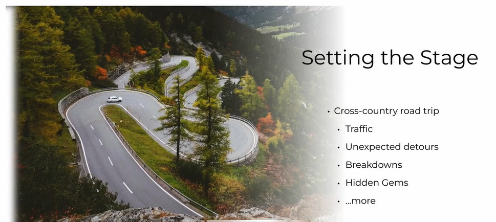
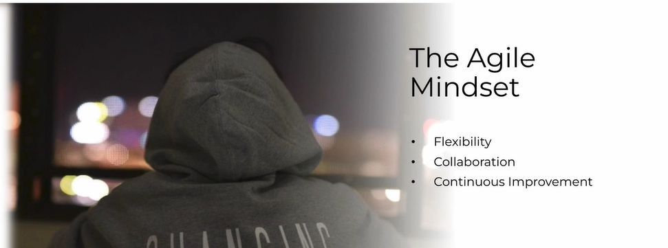

# Module 1 - Introduction to Agile

## What is Agile?

```txt
Hello everyone. Welcome to the exciting world of
Agile. Today we are diving into the heart of agile
methodologies, discovering what makes it such a
game changer in the

software development landscape. So let's get
started on this journey of exploration. Imagine
you're planning a cross country road trip.

You've got your destination, but along the way,
you might hit traffic jams, unexpected detours, or
even discover hidden gems that you'd never find

with a rigid route. Well, that's similar to how Agile
works. It's like the GPS of software development.
It helps you navigate changing landscapes,
respond

to surprises, and ensures that you arrive at your
destination successfully, no matter the route. So
at its core, agile is a mindset.

It's about valuing flexibility, collaboration, and
continuous improvements. Think of it as a set of
guiding principles that shape the way we
approach projects,

fostering adaptability in an ever evolving
environment. So agile isn't just a buzzword, it's a
carefully designed approach.
```





1. Embrace Change
2. Customer Collaboration
3. Delivering Value

Our third principle is delivering
value instead of waiting months for the project to complete.

Agile promotes delivering smaller increments of value regularly. So it's like enjoying a series of scenic stops on the road trip instead of waiting for the final destination to see something exciting.

4. Iterate and Improve

## The Agile Manifesto

* Individuals and interactions over processes and tools.
* Working software over comprehensive documentation.
* Customer collaboration over contract negotiation.
* Responding to change over following a plan.

Scenario example - 

```txt
The scenario is, let's say a software
team is developing a new app for a client. During a meeting, the team
prioritizes delivering a functional prototype to the
client for early feedback

that's valuable in action. They focus on quickly
coding the core features of the app, instead of
spending too much time writing

detailed documentation about it. Again, more
valuable. They frequently collaborate with the
client, adjusting the features based on their
evolving needs.

Again, more valuable. When the client requests
changes, the team adapts quickly, making
adjustments to the app's design and functionality.

This way, the team delivers a product that's
aligned with the client's vision that's agile. So in a
nutshell, Agile is about flexibility, collaboration,

delivering value, and embracing change. It's like
having a GPS that guides us through the winding
roads, unexpected detours, and the amazing
discoveries, all while ensuring

that we reach our software development
destination with success.
```