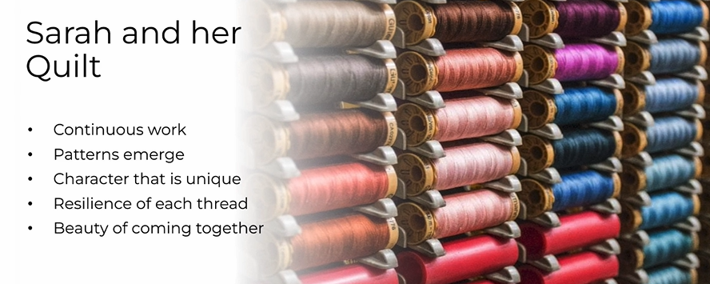
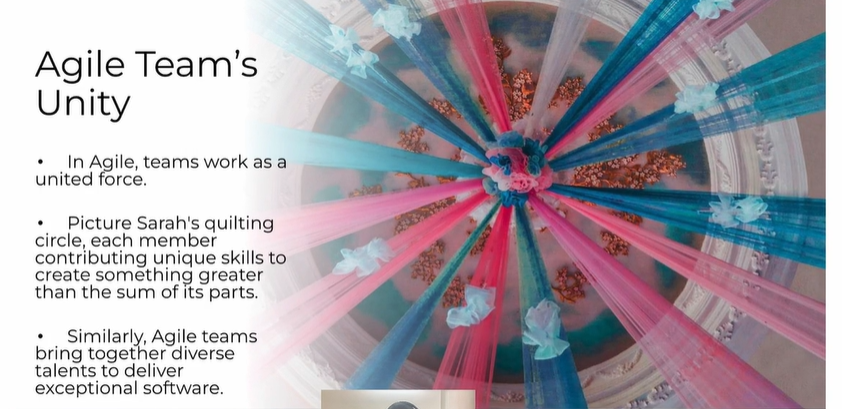
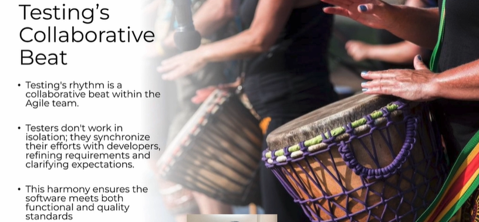
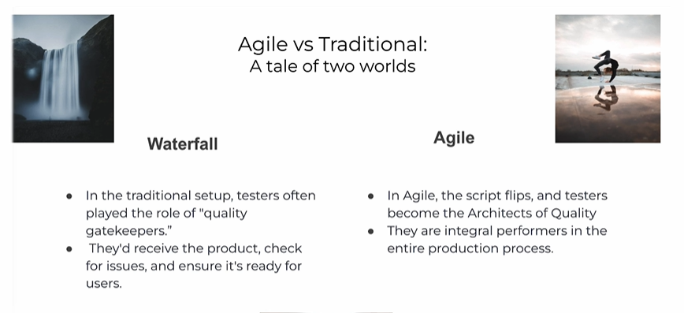
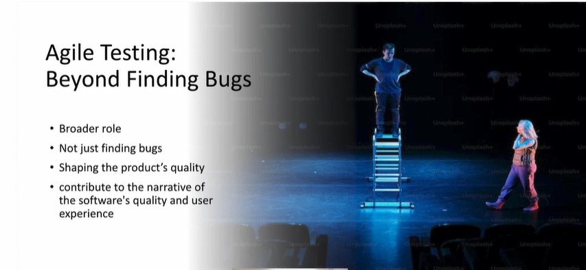
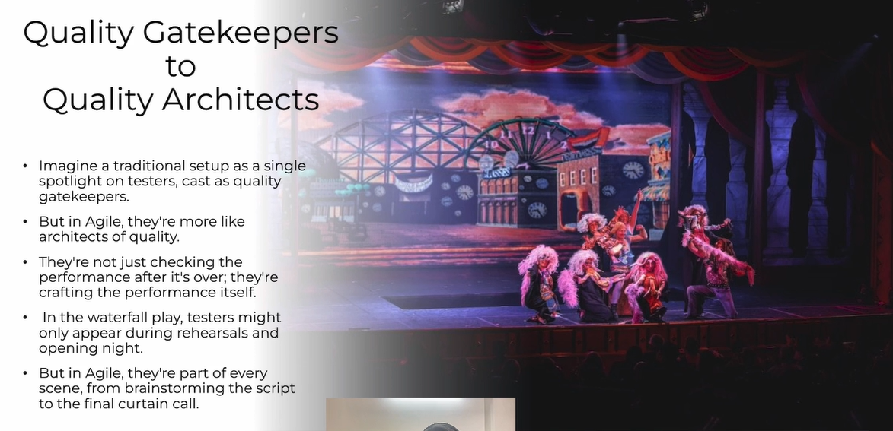

# Module 2 – Introduction to Agile Testing

## What is Agile Testing?


```txt
Today we are going to weave software testing into this agile fabric.
Imagine agile as a quilt and testing as the threads that run through it,
adding strength, color, and cohesion to the who
picture. 
Think of agile testing as the intricate
threads that connect every part of the development
process. Just like weaving threads into a fabric,
fabric creates a pattern. Agile testing creates a
pattern of quality throughout the software lifecycle.
```



```txt
Imagine Sarah a skilled weaver. She's creating a
quilt for a dear friend as she adds each thread.

The quilt gains character resilience and beauty.
Similarly, in agile testing, each test we create is a
thread woven with care, ensuring the software's
quality and functionality and the result at the end.
```

```txt
Agile testing thrives on collaboration, so testers work closely with
developers, product owners, and stakeholders to understand the
requirements, provide feedback and catch issues
early. 
This collaborative approach ensures a
harmonious blend of perspectives.
```

## Embracing Agile's Heart

How Teams Work Together



## Testing's Collaborative Beat



```txt
So as we wrap up,
remember that agile testing isn't just an
afterthought. It's an integral part of the process.

Just like Sarah's threads bind her quilt, agile
testers bind the development process with
quality, ensuring a seamless and beautiful
outcome.
```

## The Role of Agile Testers


## Unmasking the Shapeshifting Tester's Role in Agile Contexts




```txt
Imagine an Agile Team as a theater troop.
Each member contributing their unique talents to create a mesmerizing performance. In this agile theater, testers aren't just sitting in the audience

waiting for their queue. They are on stage acting
alongside developers, designers, and other
stakeholders. In the agile play. Testers have a
broader role.

It's not just about finding bugs, it's about shaping
the story of quality. Just as actors contribute to a
place, narrative

testers contribute to the narrative of the
software's quality and the user's experience. Let
us now unpack the ways testing evolves in Agile.
```



### Unpacking the ways Testing evolves in Agile



## Nova's Agile Adventure


```txt
Meet Nova, an agile tester on our dream team. Her story
beautifully illustrates how Agile testing is like a symphony

where every note contributes to a harmonious call. Nova
joins an agile team working on a mobile app. In the
traditional waterfall days,

she would have entered at the testing phase only. But in
Agile, she's there from day one, co-creating the app.

Imagine Nova as a partner to the developers. When the
code is being crafted, she's there offering inputs on
potential pitfalls,

design suggestions and improvements. It's like she's not
just watching the dance, she's leading with her own steps.
As the app takes shape, Nova is not waiting backstage.

She's involved in the continuous integration, ensuring that
each part fits the whole. Her testing isn't just a separate
act.

It's seamlessly woven into the entire development cycle.
And when the curtains rise on the final act, Nova's role isn't
just about finding defect.

She has contributed to the entire performance from
shaping the requirements to ensuring a top-notch user
experience at the end.

So as we conclude Nova's journey, remember that agile
testers like her are the architects of quality. Their role isn't
confined to finding defect.

They are the glue that binds the team Together, they are
the quality enhancers and the drivers of excellence. Thank
you and see you in the next lesson.
```