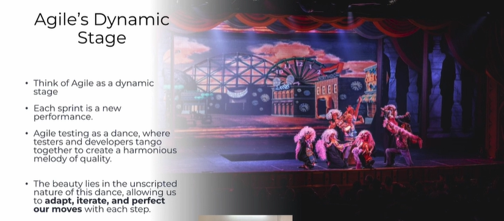

# Module 3 – Where does testing fit into Agile?

## Testing’s Dance in Agile’s Unscripted Symphony

### Choreographing Quality in Agile's Dynamic Context

### 1. Choreographing Test Flows in Agile's Unscripted Melody